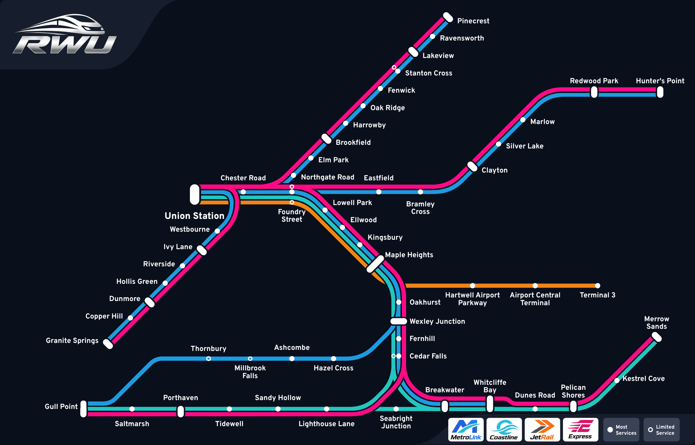

---
hide:
  - navigation
  - toc
---
# Rail Works Universe Wiki

Welcome to the wiki for **Rail Works Universe (RWU)**, a railway game on Roblox. You can drive trains for four companies, work as a conductor, signaler, dispatcher, station staff or maintenance, or ride as a passenger.

| | |
|---|---|
| Stations | [55](stations/index.md) with 130 platforms |
| Routes | [47](lines/index.md) |
| Trains | [6 classes](trains/index.md) in 126 combinations of company, livery and length |
| Track | about 188 miles |
| Signals | 979 |
| Sets of points | 697 |

-   **[Live map](live.md)**

    ---

    Who is playing right now and which train they are on.

-   **[Network map](map.md)**

    The line map: click any station to open its page.

-   **[Stations](stations/index.md)**

    Every station with its platforms and the routes that call there.

-   **[Routes](lines/index.md)**

    All 47 routes, stop by stop, in both directions.

-   **[Trains](trains/index.md)**

    The six classes, their sizes and liveries.

-   **[Companies](companies/index.md)**

    MetroLink, Express, JetRail and Coastline.

-   **[Jobs](jobs/index.md)**

    The six jobs and their ranks.

The station, route and train pages are generated from the game's own data (last export: 2026-11-13). See [About this wiki](about.md) for how to edit it.
