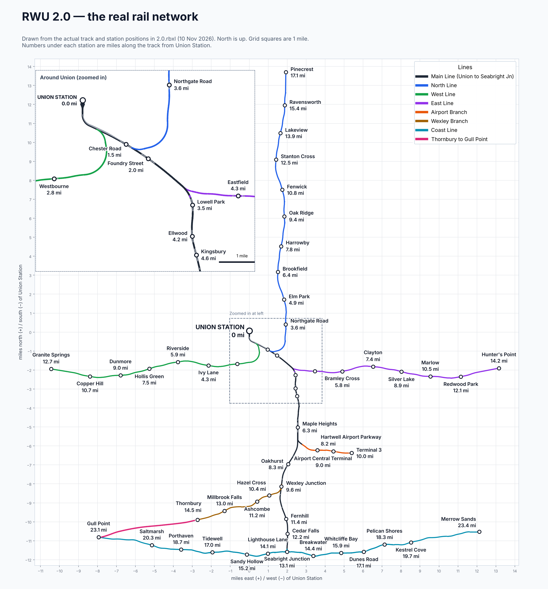

---
hide:
  - navigation
  - toc
---
# Network map

The Rail Works Universe line map. Drag to move, scroll or pinch to zoom, and click a station to open its page. To see who is driving right now, open the [live map](live.md).

  
<button data-act="in" title="Zoom in">+</button><button data-act="out" title="Zoom out">&minus;</button><button data-act="fit" title="Show everything">&#9633;</button>

  
Drag to move, scroll to zoom, click a station

<link rel="stylesheet" href="../assets/map.css">

## To scale

The same network drawn to scale, with miles along the track from Union Station.

